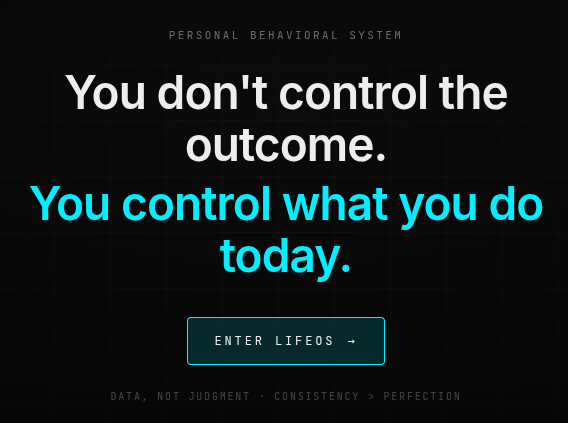
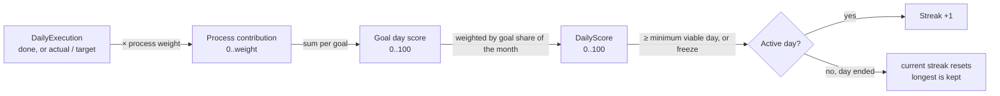

# LifeOS


A personal **behavioral feedback system**. 

LifeOS translates lyour goals into controllable daily processes, measures
execution  and adapts every week:

```
Monthly Goals → Daily Processes → Daily Score → Streak & Consistency → Weekly Reflection → System Improvement
```


## Stack

- **Angular 19**, standalone components, signals, Angular Router, Reactive Forms
- **SQLite in the browser** via `sql.js` (WebAssembly) — the real SQLite engine
  running in the tab. The whole database is serialised to a byte array and
  written to **IndexedDB** after every mutation, so a refresh or restart never
  loses data. No server — deployable as a static site.
- **Data vault** (Settings → Data vault): link the database to a real
  `lifeos.sqlite` file on your disk (File System Access API, Chromium/Brave) and
  every change is written there too — a portable, user-owned copy to back up or
  sync. Plus manual **Export / Import** in any browser.

## Run

```bash
npm install
npm start            # http://localhost:4200
```

The app starts empty. Create your first life area and monthly goal from the
Goal Wizard (**+ NEW GOAL**).

Your data lives in this browser by default. For a copy you own, open
**Settings → Data vault** and either **Save my data to a file…** (Brave / Chrome —
keeps `lifeos.sqlite` on disk in sync automatically) or **Export** it manually.
Wipe everything from **Settings → Data → Reset system**.

For a detailed explanation of the scientific foundations, research findings, and design rationale behind the system, see [`research.md`](./reaseach.md).


## Data model

Nine SQLite tables (`src/db/schema.ts`, schema v3). Solid lines are real foreign keys, all `ON DELETE CASCADE`: deleting a goal removes its processes and their check-ins. Dotted lines are derived: those rows are recomputed from others, not referenced by id.


### How a check-in becomes a streak



### TypeScript entities

Repositories (`src/core/repos.ts`) map snake_case columns to camelCase interfaces in `src/core/models.ts`. Booleans are stored as `0/1` and dates as `YYYY-MM-DD` text.

| Table | Interface | Notes |
|---|---|---|
| `life_area` | `LifeArea` | |
| `monthly_goal` | `MonthlyGoal` | `weight` is its share of the month |
| `process` | `Process` | `targetValue > 1` makes it quantitative |
| `daily_execution` | `DailyExecution` | one row per process per day |
| `daily_score` | `DailyScore` | one row per day, recomputed after every check-in |
| `streak` | `Streak` | single row, recomputed from `daily_score` |
| `weekly_reflection` + `action_item` | `WeeklyReflectionWithItems` | items are saved together with their reflection |
| `setting` | `AppSettings` | key/value pairs, read with defaults |

Screens don't read tables directly. They use view models built by `src/core/analytics.ts`, such as `TodayView`, `GoalDetailView`, `MonthSummary`, `InsightsView`, `MonthlyReviewView` and `ScoreSeries`.

