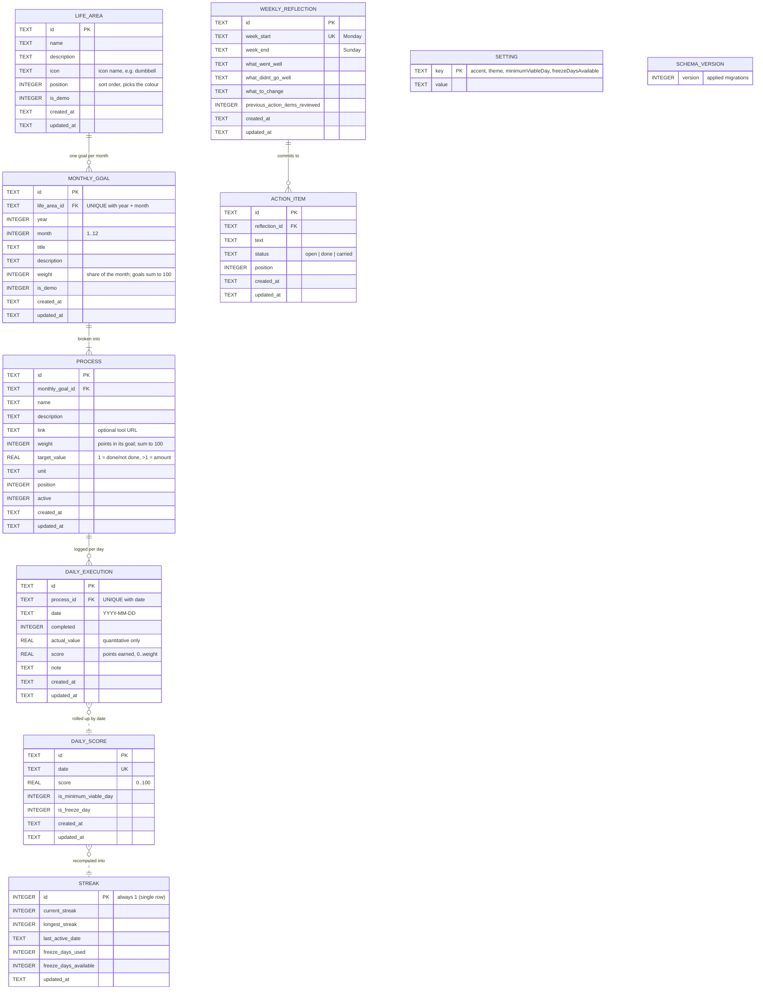
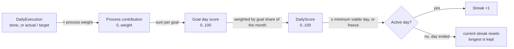

# LifeOS (React)

A playful remake of LifeOS, the personal behavioural feedback system. The concept and the data are the same; the interface is new.

```
Monthly Goals → Daily Processes → Daily Score → Streak & Consistency → Weekly Reflection → System Improvement
```

## Stack

- **React 19 + Vite + TypeScript**, React Router, Framer Motion, canvas-confetti
- **SQLite** via `sql.js` (WebAssembly) running in the page, saved to **`data/lifeos.sqlite`** in this folder
  by a tiny dependency-free Node server (`server.mjs`, localhost only). It's an ordinary SQLite file you can copy, back up, or open with any SQLite tool.
- Before the first save of each day the previous file is copied to `data/backups/` (30 days kept), and again before any import or reset.

## Run

```bash
./start.sh            # installs/builds when needed, serves http://localhost:4300, opens the browser
./start.sh --dev      # hot-reloading dev server (also saves to data/lifeos.sqlite)
npm test              # scoring/streak rules, import + migration, every screen renders, click behaviour
```

Options: `PORT=5000 ./start.sh`, `NO_OPEN=1 ./start.sh`, `LIFEOS_DATA=/some/folder ./start.sh` (store the database elsewhere).

## Bringing your data over

The schema is **identical** to the Angular LifeOS (v3, same tables, same columns), so files move both ways without loss.

1. In the original app: **Settings → Data vault → Export** (downloads `lifeos-YYYY-MM-DD.sqlite`).
2. In this app: drop that file on the welcome screen, or go to **Settings → Import & export**.
   You'll see what's inside (areas, goals, check-ins, reflections) before anything is replaced.

Older exports (schema v1/v2) are migrated automatically. If you already have a `lifeos.sqlite` vault file from the Angular app, you can also just copy it to `data/lifeos.sqlite` while the app is stopped.

## Data model

Nine SQLite tables (`src/db/schema.ts`, schema v3). Solid lines are real foreign keys, all `ON DELETE CASCADE`: deleting a goal removes its processes and their check-ins. Dotted lines are derived: those rows are recomputed from others, not referenced by id.



### How a check-in becomes a streak



### TypeScript entities

Repositories (`src/core/repos.ts`) map snake_case columns to camelCase interfaces in `src/core/models.ts`. Booleans are stored as `0/1` and dates as `YYYY-MM-DD` text.

| Table | Interface | Notes |
|---|---|---|
| `life_area` | `LifeArea` | |
| `monthly_goal` | `MonthlyGoal` | `weight` is its share of the month |
| `process` | `Process` | `targetValue > 1` makes it quantitative |
| `daily_execution` | `DailyExecution` | one row per process per day |
| `daily_score` | `DailyScore` | one row per day, recomputed after every check-in |
| `streak` | `Streak` | single row, recomputed from `daily_score` |
| `weekly_reflection` + `action_item` | `WeeklyReflectionWithItems` | items are saved together with their reflection |
| `setting` | `AppSettings` | key/value pairs, read with defaults |

Screens don't read tables directly. They use view models built by `src/core/analytics.ts`, such as `TodayView`, `GoalDetailView`, `MonthSummary`, `InsightsView`, `MonthlyReviewView` and `ScoreSeries`.

## What's the same

- Process contribution = weight × completion ratio. Process weights in a goal sum to 100. Goal weights in a month sum to 100.
- Daily score = goal scores weighted by their share of the month (legacy goals with no weight are averaged equally).
- Minimum viable day, freeze days, and a streak that never erases history.
- Weekly reflection with action items carried week to week; monthly review.

## What's new

- **Today as a quest board**: tap a card to complete a process; quantitative processes use a stepper. Sparkles appear when you complete one, confetti when the day is secured, fireworks at 100.
- Notes per check-in, back-filling past days, and a **freeze** button (both were already in the data model).
- Icons and colours per life area, a monthly calendar, a "month wrapped" review, light/dark/auto theme.
